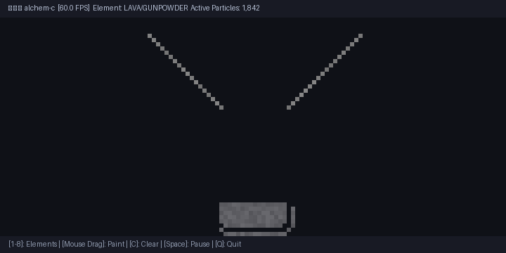

# alchem-c

> High-performance terminal falling-sand and cellular automata chemical reaction engine in pure C99.



[](https://github.com/omchandra0907-jpg/alchem-c/actions/workflows/ci.yml)
[](https://opensource.org/licenses/MIT)
[](https://en.wikipedia.org/wiki/C99)

> **🌐 Live Interactive Web Demo:** [https://omchandra0907-jpg.github.io/alchem-c/](https://omchandra0907-jpg.github.io/alchem-c/)

[](https://omchandra0907-jpg.github.io/alchem-c/)

---

## Highlights

- **Cache-Friendly 1D Grid Memory**: The entire simulation grid is laid out in a single contiguous `cell_t *cells` array (`width * height`) rather than fragmented pointer arrays (`cell_t **`), providing peak spatial cache locality and single-syscall cleanup.
- **Bit-Packed 4-Byte Cell Struct**:
  ```c
  typedef struct {
      uint8_t type;   /* Element identifier (Air, Sand, Water, Lava, etc.) */
      uint8_t clock;  /* Parity bit flipped per tick to prevent double-updating */
      uint8_t life;   /* Burn/decay/dissolve countdown counter */
      uint8_t tint;   /* Organic color jitter (0..15) for natural texture */
  } cell_t;
  ```
- **Unbiased Symmetrical Physics**: Bottom-to-top evaluation (`height - 1` down to 0) with alternating horizontal scan directions (`x` sweep oscillates left-to-right and right-to-left based on `(y + clock) % 2`), eliminating directional drift in sand mounds and fluid dispersal.
- **Single-Syscall Flicker-Free Rendering**: Packs two vertical cells into each terminal character using the Unicode upper half-block (`▀` / `\u2580`) with 24-bit TrueColor ANSI escape sequences. The entire viewport is composed inside a pre-allocated memory buffer and flushed with a single `write(STDOUT_FILENO, ...)` syscall per tick.
- **Zero-Setup Quick Run**: Bundles a ready-to-run interactive showcase in `samples/run_demo.sh` that launches offline in under 3 seconds.

---

## Chemical Reaction Matrix

| Reactant A | Reactant B | Resulting Products | Behavior |
|---|---|---|---|
| **LAVA** | **WATER** | `STONE` + `STEAM` | Instant cooling, vaporizing water into rising steam |
| **FIRE** | **GUNPOWDER** | `FIRE` (Radial Blast) | Detonation shockwave igniting adjacent combustibles |
| **LAVA** | **GUNPOWDER** | `FIRE` (Detonation) | Thermal ignition creating chain reaction |
| **ACID** | `STONE` / `SAND` | `STEAM` / Dissolved | Exothermic corrosion consuming the solid over successive ticks |
| **FIRE** | **WATER** | `STEAM` | Extinguishes flame, producing dense steam clouds |

---

## Interactive Controls

| Key / Input | Action |
|---|---|
| **Mouse Drag** | Paint active element directly on the canvas (SGR mouse tracking) |
| **`1` - `8`** | Select element: `[1] Sand` `[2] Water` `[3] Lava` `[4] Acid` `[5] Gunpowder` `[6] Fire` `[7] Stone` `[8] Eraser` |
| **`+` / `-`** | Increase / Decrease brush radius (1 to 8) |
| **`Space`** | Pause / Resume physics simulation |
| **`S` / `N`** | Advance single simulation step while paused |
| **`C`** | Clear world grid |
| **`Q`** | Clean exit with terminal mode restoration |

---

## Quickstart & Build Targets

### Requirements
- GCC or Clang
- GNU Make
- Any modern terminal with TrueColor and UTF-8 support (Kitty, Ghostty, Alacritty, WezTerm, iTerm2, etc.)

### Build Release (-O2)
```bash
make release
./alchem-c
```

### Build Debug (AddressSanitizer + UndefinedBehaviorSanitizer)
```bash
make debug
./alchem-c
```

### Run Automated Headless Verification Suite
```bash
make test
```

### Zero-Setup Demo Showcase
```bash
./samples/run_demo.sh
```

---

## Architecture & Source Layout

```
alchem-c/
├── Makefile              # Builds release (-O2) and ASan/UBSan debug binaries
├── include/
│   ├── world.h           # cell_t struct, element IDs & grid API
│   └── terminal.h        # termios raw mode, mouse tracking & ANSI buffer
├── src/
│   ├── main.c            # Fixed-timestep loop (60 FPS via clock_gettime)
│   ├── physics.c         # Cellular automata rules & chemical reaction table
│   ├── input.c           # SGR mouse drag painting (\033[?1006h) & hotkeys
│   └── render.c          # Half-block frame compositor & HUD status bar
├── tests/
│   └── test_reactions.c  # Headless assertions verifying reaction rules
├── samples/
│   └── run_demo.sh       # Zero-setup showcase runner
└── assets/
    └── demo.gif          # High-framerate visual demonstration
```

---

## License

Distributed under the MIT License. Built with passion by [omchandra0907-jpg](https://github.com/omchandra0907-jpg).
